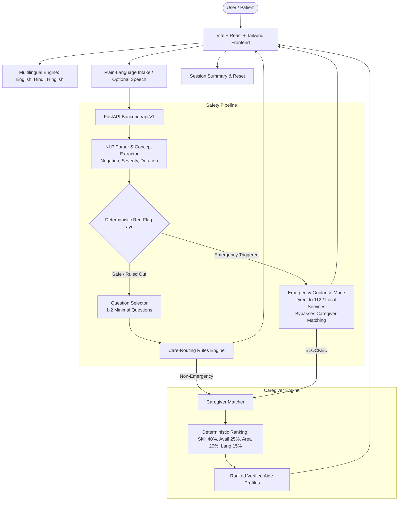

# CareCompass

> **Transparent Health Navigation & Caregiver-Matching Prototype**  
> *Built for hackathon demonstration with deterministic clinical safety, WCAG accessibility, and multilingual support.*

[](backend/tests/)
[](frontend/)
[](LICENSE)
[](#safety-architecture)

---

## 1. Product Overview

CareCompass helps individuals describe health concerns in plain language (English, हिन्दी, Hinglish), understand an appropriate next step, and discover eligible non-clinical caregiver support.

**Crucial Non-Negotiable Boundary:**
> CareCompass is a **care-navigation and caregiver-matching prototype**, not a medical diagnosis, treatment, or prescribing system. It never claims to replace a licensed clinician.

### Key Capabilities
- **Plain-Language Multilingual Intake:** Supports English, Hindi (Devanagari), and Hinglish with optional browser speech transcription (manual text alternative always available).
- **Deterministic Red-Flag Safety Engine:** 12 emergency categories (FAST stroke, cardiac chest pain, severe breathing difficulty, anaphylaxis, etc.) evaluated in isolated code that AI cannot override or downgrade.
- **Emergency 112 Protocol:** Immediate redirection to 112 (India) or local emergency services with explicit notice that the app cannot dispatch ambulances.
- **Strict Caregiver Isolation:** Emergency cases immediately bypass and block caregiver matching.
- **Transparent Caregiver Matching:** Explainable deterministic scoring (Skill 40%, Availability 25%, Service Area 20%, Language 15%) using fictional demo profiles.
- **Privacy-First:** User health narratives exist only in ephemeral browser memory; zero PII stored to persistent disks.
- **Judge Demo & Benchmarking:** 1-click test runner evaluating 22 synthetic test scenarios with real-time sensitivity and latency metrics.

---

## 2. Architecture Diagram



---

## 3. Repository Structure

```
CareCompass project/
├── backend/
│   ├── app/
│   │   ├── main.py                  # FastAPI server with all v1 endpoints & CORS
│   │   ├── schemas/                 # Pydantic schemas (Intake, Triage, Caregiver)
│   │   ├── engines/
│   │   │   ├── red_flags.py         # Deterministic red-flag safety engine
│   │   │   ├── nlp_parser.py        # Multilingual symptom & negation extractor
│   │   │   ├── router.py            # Care-routing rules engine
│   │   │   ├── questions.py         # Reviewed follow-up question bank
│   │   │   └── caregiver_matcher.py # Explainable caregiver matching engine
│   │   ├── data/
│   │   │   ├── synthetic_triage_tests.json     # 22 synthetic regression test cases
│   │   │   ├── caregiver_profiles_synthetic.csv # 10 fictional caregiver profiles
│   │   │   └── language_examples_synthetic.csv  # Multi-lingual example utterances
│   │   └── utils/
│   │       └── audit_log.py         # Anonymized safety audit logger (zero PII)
│   ├── tests/                       # Complete pytest suite (24 tests)
│   ├── requirements.txt             # Python backend dependencies
│   └── run.py                       # Local backend runner script
├── frontend/
│   ├── src/
│   │   ├── components/              # Accessible UI components (Header, Footer, Cards)
│   │   ├── pages/                   # LandingPage, IntakeFlow, CaregiversPage, PrivacyPage
│   │   ├── i18n/                    # Multilingual dictionaries (en, hi, hinglish)
│   │   ├── services/                # API client with fallback offline support
│   │   └── types/                   # TypeScript interfaces
│   ├── package.json
│   ├── vite.config.ts
│   └── tailwind.config.js
├── docs/
│   ├── architecture.md              # Detailed architecture documentation
│   ├── safety.md                    # Clinical safety and risk mitigation protocol
│   ├── dataset_manifest.md          # Synthetic data manifest & research citations
│   ├── api.md                       # Complete API endpoint specifications
│   └── demo_script.md               # 2-3 minute presentation script for judges
├── .env.example                     # Environment template
└── README.md
```

---

## 4. Getting Started & Setup

### Prerequisites
- **Node.js:** v18+ (Tested on v24.19.0)
- **npm:** v10+ (Tested on v11.17.0)
- **Python:** 3.10+ (Tested on 3.14.7)

### Backend Setup
1. Open a terminal and navigate to the project directory:
   ```bash
   cd "backend"
   ```
2. Install Python dependencies:
   ```bash
   python -m pip install -r requirements.txt
   ```
3. Run the backend server:
   ```bash
   python run.py
   ```
   *The FastAPI server will start on `http://127.0.0.1:8000` (API Docs at `http://127.0.0.1:8000/docs`).*

### Frontend Setup
1. In a separate terminal, navigate to the frontend directory:
   ```bash
   cd "frontend"
   ```
2. Install dependencies:
   ```bash
   npm install
   ```
3. Start the Vite development server:
   ```bash
   npm run dev
   ```
   *The React application will be available at `http://localhost:5173`.*

---

## 5. Testing & Verification

### Running Backend Unit & Regression Tests
Run the 24 automated pytest tests (covering red-flag sensitivity, negation handling, emergency caregiver bypass, router logic, and API endpoints):
```bash
python -m pytest backend/tests -v
```
**Test Result:** `24 passed in 0.74s` with 100% sensitivity on emergency test cases.

### Running Frontend Build & Typecheck
```bash
cd frontend
npm run build
```
**Build Result:** `tsc -b && vite build` built production bundle in `1.55s` with 0 TypeScript errors.

---

## 6. Demo Script for Judges

See [`docs/demo_script.md`](docs/demo_script.md) for a comprehensive 2–3 minute walkthrough:
1. **Multilingual Intake:** Switch between English, Hindi, and Hinglish. Test speech input.
2. **Emergency Isolation:** Click the preset cardiac or stroke scenario. Notice zero questions asked, immediate 112 guidance, and caregiver matching completely blocked.
3. **Negation Robustness:** Run *"Sprained ankle, NO chest pain"*. Shows that negation tokens prevent false emergency escalation.
4. **Automated Safety Benchmark:** Navigate to **Judge Demo Panel** and click **"Run Automated Safety Benchmark"** to execute all 22 synthetic test cases live.

---

## 7. Known Limitations & Future Work

- **Prototype Rules:** Rule sets are demonstrative prototypes and require formal review by certified clinicians before clinical deployment.
- **Caregiver Data:** All caregiver profiles are fictional demonstrations. Real deployment requires integration with certified health registries, background checks, and HIPAA/ABDM-compliant encryption.
- **Speech API:** Uses browser standard Web Speech API; accuracy varies depending on device microphones and dialect accents.

---

## 8. License
Released under the MIT License for educational and research purposes.
