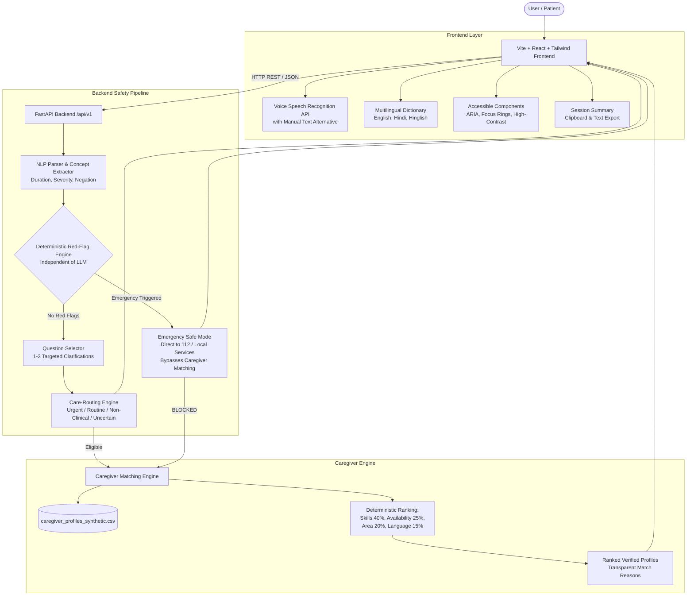

# CareCompass — System Architecture

CareCompass is a privacy-first, accessible care-navigation and caregiver-matching hackathon prototype. It translates everyday health concerns expressed in plain language into conservative next-step recommendations and connects patients with verified non-clinical support.

---

## High-Level Architecture Diagram

---

## Architectural Modules & Separation of Concerns

### 1. Deterministic Red-Flag Safety Layer (`app/engines/red_flags.py`)
- **Isolation:** Operates independently of any LLM or generative AI.
- **Authority:** Generative AI is strictly forbidden from downgrading or overriding an emergency alert.
- **Coverage:** Checks 12 acute clinical categories: FAST Stroke, Acute Coronary Syndrome (Chest Pain), Severe Respiratory Distress / Cyanosis, Unresponsiveness, Prolonged Seizures (>5 min), Severe Pulsatile Bleeding, Anaphylaxis, Poisoning / Caustic Ingestion, Major High-Impact Trauma, Pregnancy Obstetric Emergencies, Severe Third-Degree Burns, and Active Self-Harm Crisis.
- **Negation Shielding:** Local look-back and look-ahead token inspection prevents negated statements (e.g. *"I sprained my ankle, NO chest pain"*, *"koi chest pain nahi"*) from triggering false emergency alerts.

### 2. NLP Concept Extraction & Normalization (`app/engines/nlp_parser.py`)
- Normalizes free-text utterances into structured symptoms, severity levels (*mild*, *moderate*, *severe*), duration markers, and negation flags.
- Multilingual vocabulary supports English, Hindi (Devanagari), and Hinglish (Latinized colloquial Hindi).
- 100% offline rule-based fallback ensures zero downtime if external cloud AI keys are omitted.

### 3. Targeted Follow-Up Selector (`app/engines/questions.py`)
- Selected from a reviewed, curated question bank.
- Asks at most 1 to 2 targeted questions.
- Explains the clinical and operational rationale (`why_asked`) for full patient transparency.
- **Emergency Priority:** If an emergency red flag is detected, follow-up questions are immediately bypassed to prevent dangerous delays.

### 4. Care-Routing Engine (`app/engines/router.py`)
- Produces provisional next-step classifications:
  - `EMERGENCY`: Immediate emergency care; call 112.
  - `URGENT_IN_PERSON`: Prompt in-person evaluation within 24 hours.
  - `ROUTINE_CLINICAL`: Standard outpatient general practitioner appointment.
  - `NON_CLINICAL_SUPPORT`: Home companionship, mobility assistance, respite care.
  - `UNCERTAIN_ROUTINE`: Inconclusive pattern; transparently recommends clinical evaluation.

### 5. Deterministic Caregiver Matcher (`app/engines/caregiver_matcher.py`)
- Matches non-clinical fictional caregiver profiles from `caregiver_profiles_synthetic.csv`.
- Filters eligibility first (verifies availability is not `unavailable`).
- Calculates explainable scores based on documented demo weights:
  - Skill Fit: 40%
  - Availability: 25%
  - Service Area: 20%
  - Language Match: 15%
- Strict Emergency Bypass: Always returns 0 matches for emergency cases.

### 6. Privacy & Safety Audit Logging (`app/utils/audit_log.py`)
- In-memory event logger recording anonymized evaluation types, urgency levels, and rule IDs.
- Zero recording of identifiable patient details or raw health narratives.
- Ephemeral session memory cleared immediately upon user reset request.
