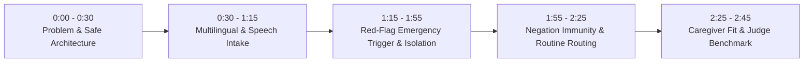

# CareCompass — 2–3 Minute Hackathon Demo Script

This script guides presenters and hackathon judges through a live demonstration of CareCompass's deterministic safety pipeline, multilingual intake, and explainable caregiver matching.

---

## Demo Overview (Total: 2 min 45 sec)

---

## Step-by-Step Script

### Part 1: Problem & Safe Architecture (0:00 - 0:30)
- **Action:** Open landing page at `http://localhost:5173`.
- **Spoken:**
  > *"Judges, when someone experiences a health problem, navigating where to go is confusing. Generative AI chatbots often hallucinate diseases or guess emergency levels dangerously. CareCompass takes a fundamentally safer approach: it acts purely as a care-navigation and caregiver-matching prototype—never diagnosing or prescribing. Most importantly, all emergency safety checks are deterministic code that no AI can ever downgrade or bypass."*

---

### Part 2: Multilingual Intake & Optional Speech (0:30 - 1:15)
- **Action:**
  1. Click **Language Selector** in the header and switch to **हिन्दी** or **Hinglish**.
  2. Click **Get Care Guidance**.
  3. Show the optional **Speak Concern** button, explain the visible text alternative, then type or paste:
     > *"Dadi ke liye caregiver chahiye jo chalne aur dawa lene me help kare."*
  4. Click **Continue**.
- **Spoken:**
  > *"CareCompass supports English, Hindi, and Hinglish. Here, our patient describes needing home assistance for an elderly grandmother. The system extracts structured concepts, asks only one targeted follow-up question regarding daily assistance level, and transparently explains why this question is being asked."*

---

### Part 3: Emergency Red-Flag Safety Trigger & Isolation (1:15 - 1:55)
- **Action:**
  1. Click **Demo Mode & Benchmarks** in the header.
  2. Click **EMERG-002: Crushing chest pain** or type:
     > *"I feel crushing pressure in my chest radiating down my left arm with cold sweats."*
  3. Click **Continue**.
  4. Point out the immediate transition to the **Emergency Alert Screen**.
- **Spoken:**
  > *"Now watch what happens with an emergency. The deterministic red-flag engine instantly detects cardiac red flags. Notice that it does NOT delay the user with questions, and it displays emergency advice immediately: dialing 112 in India, immediate safety positioning, and an explicit disclaimer that CareCompass cannot dispatch ambulances. If we inspect Caregiver Matching, it is strictly disabled—emergency cases are 100% blocked from caregiver routing."*

---

### Part 4: Negation Handling Test (1:55 - 2:25)
- **Action:**
  1. Click the preset pill: *"I sprained my ankle playing football. I have NO chest pain and NO breathing trouble."*
  2. Click **Continue**.
  3. Observe that it routes to **Urgent In-Person Medical Assessment** (for ankle examination) rather than a cardiac emergency.
- **Spoken:**
  > *"A critical flaw in naive triage keyword engines is falsely triggering emergencies when symptoms are negated. Here, the patient explicitly states 'NO chest pain'. Our negation engine correctly verifies negation tokens, preventing panic while routing the sprain safely."*

---

### Part 5: Explainable Caregiver Fit & Judge Benchmark (2:25 - 2:45)
- **Action:**
  1. Navigate to **Caregiver Support**.
  2. Open the *"Why this caregiver was matched"* breakdown for **Aarav Sharma**.
  3. Switch to **Judge Demo Panel** and click **"Run Automated Safety Benchmark"**.
  4. Watch all 22 synthetic test cases pass with 100% sensitivity and 0 under-triage.
- **Spoken:**
  > *"Finally, caregiver matching uses a transparent formula: skill fit 40%, availability 25%, area 20%, and language 15%. In our judge benchmark panel, you can run all 22 synthetic regression tests in under 2 seconds, proving zero false-negative emergencies. Everything runs locally, respects WCAG accessibility, and saves zero private health logs."*
